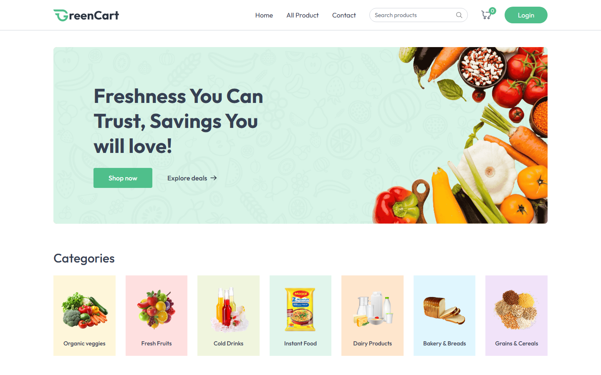

# GreenCart — Full-Stack Organic Grocery E-Commerce Platform

[](#)
[](#)
[](#)

> A modern full-stack organic grocery e-commerce web application featuring fresh produce catalogs, categorized filtering, cart management, address selection, and seamless checkout.

---

## Preview



---

## Overview

GreenCart provides an end-to-end shopping experience for fresh organic vegetables, fruits, dairy, and household essentials. It combines a responsive React frontend powered by Vite and Tailwind CSS with a scalable Express and MongoDB backend.

---

## Key Features

- **Product Catalog & Categorization**: Filter groceries by Vegetables, Fruits, Dairy, Bakery, Drinks, and Pantry essentials.
- **Dynamic Shopping Cart**: Real-time quantity updates, cart totals, delivery charges, and instant price recalculation.
- **Address & Delivery Scheduling**: User delivery address management with scheduling options.
- **Promotional Banners & Deals**: Featured products, seasonal discount badges, and responsive promo cards.
- **Responsive Mobile-First Design**: Optimized layout across mobile phones, tablets, and desktop displays.

---

## Tech Stack

- **Frontend**: React 18, Vite, Tailwind CSS, Lucide React Icons
- **Backend**: Node.js, Express.js, REST API endpoints
- **Database**: MongoDB with Mongoose ORM
- **State Management**: React Context API

---

## Getting Started

### Prerequisites
- Node.js (v18+)
- MongoDB instance (local or Atlas)

### Setup & Run
1. Install client dependencies:
   ```bash
   cd GreenCart
   npm install
   ```
2. Configure `.env` file:
   ```env
   VITE_BACKEND_URL=http://localhost:5000
   ```
3. Start development server:
   ```bash
   npm run dev
   ```
4. Build for production:
   ```bash
   npm run build
   ```

---

## Project Structure

```
GreenCart/
├── docs/
│   └── screenshot.png         # Live preview screenshot
├── public/                    # Static assets & icons
├── src/
│   ├── assets/                # Product images and banner graphics
│   ├── components/            # Navbar, Footer, ProductCards, CartDrawer
│   ├── context/               # Global Cart & Auth Context
│   ├── pages/                 # Home, Products, Cart, Checkout
│   ├── App.jsx                # Root router & application wrapper
│   └── main.jsx               # React DOM entry point
├── package.json
└── vite.config.js
```
